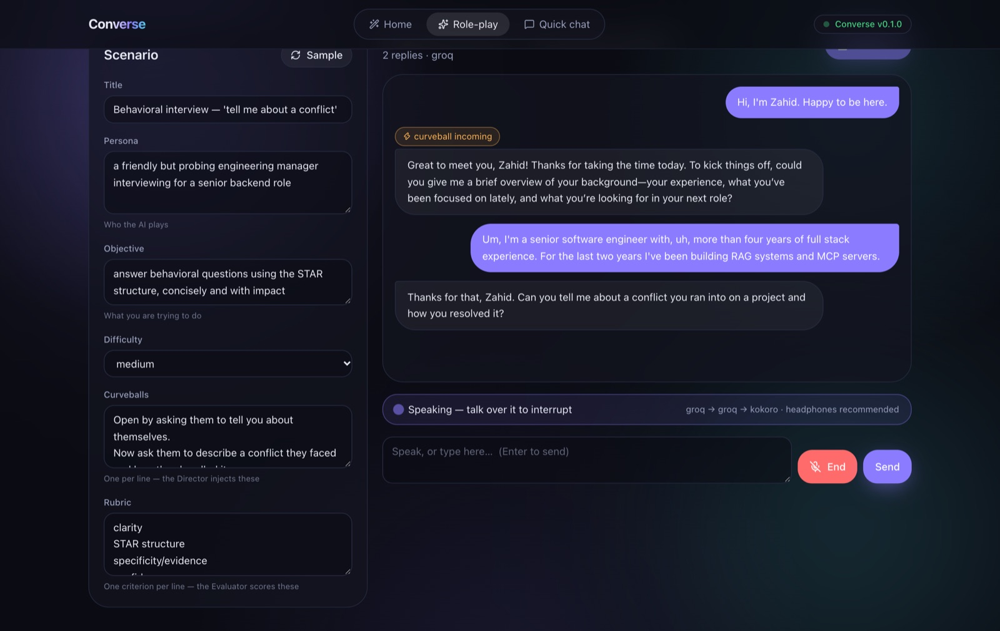
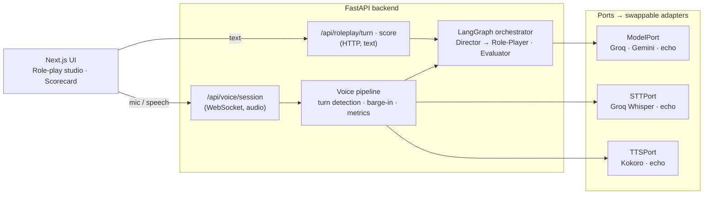
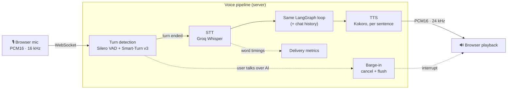
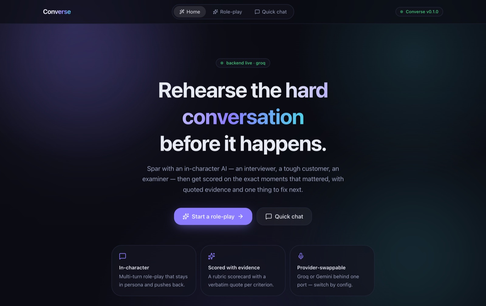
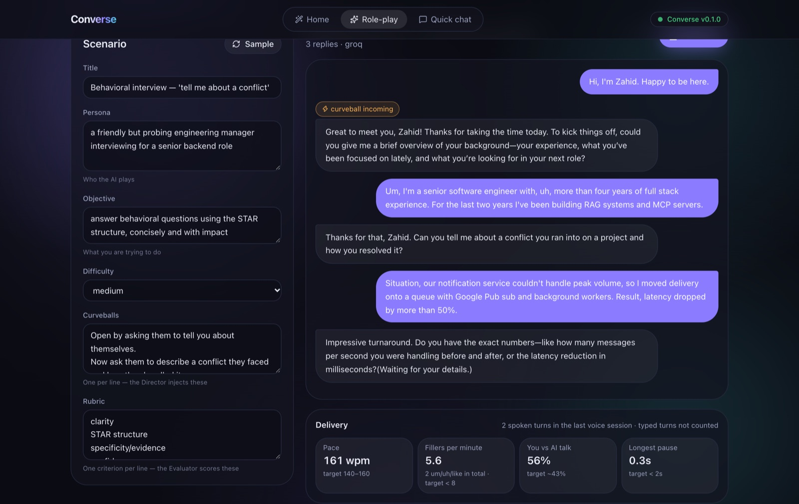
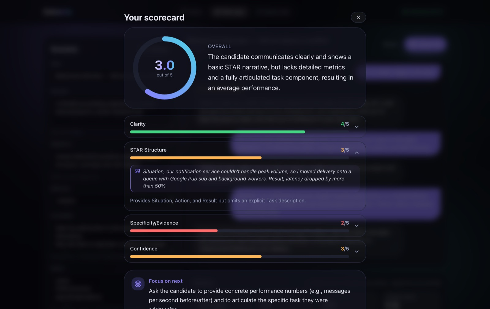
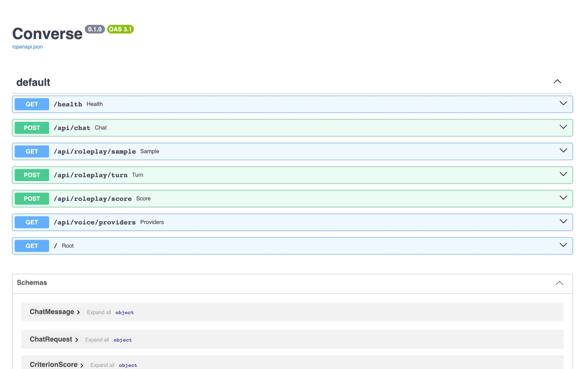

# Converse

**Rehearse the hard conversation before it happens.** Talk (or type) to an in-character AI —
an interviewer, a tough customer, an examiner — then get a rubric scorecard with **verbatim
quotes as evidence** and delivery metrics on *how* you spoke.

It's built as **one engine, many products**: every capability sits behind a swappable *port*,
and a product is just a "pack" (persona + rubric + scenario). v1 pack: a spoken-English and
interview coach.



| | |
|---|---|
| 🎙️ **Voice or text, one conversation** | Type, then talk, then type again — the AI keeps the whole thread. Interrupt it mid-sentence; it stops. |
| 🧑‍⚖️ **Scored with evidence** | An LLM judge grades each rubric criterion 1–5 and quotes the exact line it based the score on. |
| 📈 **Delivery metrics** | Pace, fillers per minute, talk:listen ratio, longest pause — measured from your actual audio. |
| 💸 **$0 to run** | Free tiers (Groq, Gemini) + local models. No paid keys, no GPU. |

---

## Quickstart

**Needs:** Python 3.12+, Node 20+, and a free [Groq API key](https://console.groq.com/keys) (no card).

```bash
cd converse
make setup               # backend venv + deps, frontend npm install, seeds backend/.env
make providers voice     # provider SDKs + voice models (~130 MB: Silero, Smart-Turn, Kokoro)
# add your key:  GROQ_API_KEY=...  in backend/.env   (optional: GOOGLE_API_KEY for Gemini)
make dev                 # backend → http://localhost:8000 · frontend → http://localhost:3000
```

Then open <http://localhost:3000> → **Role-play** → type a greeting or click **Talk** (allow the
mic, **use headphones**) → answer the interviewer → **End** → **Score me**.

> No key yet? Everything still runs on the built-in **echo** providers (canned replies, silent
> audio) — useful to see the flow end to end.

| Command | What it does |
|---|---|
| `make dev` | backend + frontend with hot reload |
| `make test` · `make lint` | backend tests (33) · ruff |
| `make stop` | free stuck ports (:8000, :3000, :3001) |
| `make health` | provider readiness |
| `make help` | everything else |

---

## Architecture at a glance



- **The orchestrator never knows which vendor it's talking to** — only the port. Swapping Groq
  for Gemini, or Kokoro for ElevenLabs, is an adapter + config change, not a rewrite.
- **Voice is just another transport** in front of the same LangGraph brain: the text and voice
  paths share one conversation and one judge.
- **Text turn:** Scenario-Director picks a curveball → Role-Player replies in character.
  **Score:** the Evaluator returns a schema-valid `Scorecard` (score + quote + rationale per criterion).

📖 Deeper reading: [**ARCHITECTURE.md**](ARCHITECTURE.md) (why each layer exists, options &
trade-offs, workflow vs agent) · [**TDD.md**](TDD.md) (decisions, per-phase status, test strategy).

---

## Voice architecture



| Stage | Choice | Why |
|---|---|---|
| **Turn detection** | Silero VAD (*is this speech?*) + Smart-Turn v3 (*is the thought finished?*) | Waits through "let me think…" pauses instead of cutting you off. Local ONNX, ~1 ms + ~15 ms. |
| **STT** | Groq `whisper-large-v3-turbo` | Free tier, word timestamps, prompted to keep fillers ("um/uh") and spell RAG/MCP/Pub/Sub. |
| **LLM** | Groq `openai/gpt-oss-120b` (or Gemini) | Fast first token; replies kept to 1–3 spoken sentences in voice mode. |
| **TTS** | Kokoro via `kokoro-onnx` (int8) | Apache-2.0, local, ~0.5 s to first audio, ~5× realtime on CPU. |
| **Transport** | Our own WebSocket + ports | Full control and visibility. (LiveKit/Pipecat considered; Pipecat is the planned production migration.) |

**What makes it feel like a conversation** — each learned from real sessions:

| Behaviour | How |
|---|---|
| Doesn't interrupt your thinking pauses | Smart-Turn checks at 200 ms of silence, but the turn only ends after ≥500 ms; a transcript that *sounds* unfinished ("we had to…") holds 3 s more |
| You can interrupt it | ≥200 ms of your speech while it talks → generation cancelled, queued audio dropped, browser playback flushed |
| Never loses your opening words | 320 ms pre-roll buffer; if you resume mid-transcription, the first part is carried into the next turn |
| Ignores noise and keyboard clicks | mic muted while typing · turns with <250 ms of speech dropped · Whisper's "Thank you." hallucination filtered |
| Honest metrics | pauses measured by the VAD (Whisper hides silence inside word timings); talk:listen = your speech ÷ (yours + AI's) |

All voice models run **locally via onnxruntime — no torch, no GPU**. Only STT and the LLM call Groq.

---

## Screenshots

| Home | Delivery metrics |
|---|---|
|  |  |
| **Scorecard (quoted evidence)** | **API (OpenAPI docs at `:8000/docs`)** |
|  |  |

---

## API

| Method | Path | Purpose |
|---|---|---|
| GET | `/health` | app + per-provider readiness |
| POST | `/api/chat` | provider-agnostic streaming chat (SSE) |
| GET | `/api/roleplay/sample` | a ready-to-use scenario |
| POST | `/api/roleplay/turn` | one learner turn → in-character reply |
| POST | `/api/roleplay/score` | transcript → rubric `Scorecard` |
| WS | `/api/voice/session` | voice session (protocol below) |
| GET | `/api/voice/providers` | STT/TTS adapter readiness |

<details>
<summary><b>Voice WebSocket protocol</b></summary>

| Direction | Frame | Meaning |
|---|---|---|
| client → server | text `{scenario?, messages?, provider?, stt?, tts?}` | first frame: session config (+ prior chat history) |
| client → server | binary | mic audio, PCM16 mono 16 kHz |
| client → server | text `{"type":"text","text":…}` | a typed turn mid-session |
| client → server | text `{"type":"end"}` | end → server sends delivery metrics, then closes |
| server → client | text `{"type":"state"\|"transcript"\|"interrupt"\|"metrics"\|"error",…}` | events |
| server → client | binary | agent speech, PCM16 mono 24 kHz |

Browser origins must be listed in `CORS_ORIGINS` — the WebSocket checks `Origin` itself (CORS
doesn't cover WebSockets).
</details>

---

## Development

<details>
<summary><b>Test voice without a browser</b> (scripted mic over the real WebSocket)</summary>

```bash
cd backend
say -o /tmp/me.wav --data-format=LEI16@16000 "Um, so I led the migration. [[slnc 1500]] It was hard."
.venv/bin/python scripts/voice_client.py /tmp/me.wav --stt groq --tts kokoro
afplay /tmp/agent.wav      # hear the reply
```
</details>

<details>
<summary><b>Debugging (VS Code)</b></summary>

Open the **`converse/`** folder so `.vscode/` is picked up.

| Config | Hot reload | Breakpoints |
|---|:--:|:--:|
| `make backend` / `make frontend` | ✅ | ✖ |
| ▶ Backend: FastAPI (debug) | ✖ | ✅ |
| ▶ Frontend: Chrome (client) · Next.js server | ✅ | ✅ |
| ▶ Testing panel → **Debug Test** on any test | — | ✅ |

The backend debug config drops `--reload` (the reloader's child process can't be attached).
Each voice step logs one line (`turn_event reason=…`, `stt_done`, `llm_reply`, `barge_in`,
`session_metrics`); learner text is only logged at `LOG_LEVEL=DEBUG`.
</details>

<details>
<summary><b>Project layout</b></summary>

```
converse/
├── README.md · ARCHITECTURE.md · TDD.md
├── backend/
│   ├── app/
│   │   ├── main.py · config.py · logging.py
│   │   ├── api/            health · chat (SSE) · agents (/roleplay) · voice (WebSocket)
│   │   ├── agents/         LangGraph graph (Director, Role-Player, Evaluator) + schemas
│   │   ├── core/
│   │   │   ├── model_port.py · voice_port.py      the ports
│   │   │   ├── providers/  echo · groq · gemini   (ModelPort adapters)
│   │   │   └── voice/      echo · groq_whisper_stt · kokoro_tts   (STT/TTS adapters)
│   │   └── voice/          pipeline · turn (VAD + Smart-Turn) · metrics · whisper_features
│   ├── scripts/voice_client.py    scripted-mic E2E client
│   ├── tests/              graph · health · voice pipeline · voice WebSocket
│   └── models/             downloaded ONNX models (gitignored)
├── frontend/               Next.js 15 · Tailwind v4 · motion
│   ├── components/         Hero · RoleplayStudio · Scorecard · QuickChat · ui
│   └── lib/                api.ts (HTTP) · voice.ts (mic, WebSocket, playback)
└── docs/screenshots/
```
</details>

---

## Status

| Phase | | |
|---|:--:|---|
| 0 · Foundations — FastAPI, Next.js, provider-swappable `ModelPort` | ✅ | |
| 1 · Multi-agent text core — LangGraph + LLM-judge scorecard | ✅ | |
| 2 · Voice — STT → LLM → TTS, turn detection, barge-in, delivery metrics | ✅ | migrating orchestration to Pipecat next |
| 3–9 · Vision · Evals & CI · Memory · Guardrails · Observability · SaaS · `create-ai-app` | ⬜ | see [TDD.md](TDD.md) §5 |

## Notes

- **Free tiers drift.** Model IDs and limits change — verify against each provider's console
  before relying on the defaults in `backend/.env.example`. Gemini's free tier trains on inputs
  and isn't available in the EEA/UK; use non-sensitive data.
- **Python 3.14:** the official `kokoro` package doesn't build (spacy); we use `kokoro-onnx`.
- **Deploying:** the frontend fits Vercel; the voice WebSocket needs a persistent host
  (Modal, Fly, a small VM) — not pure serverless.
